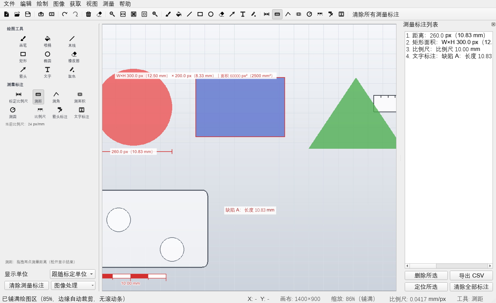
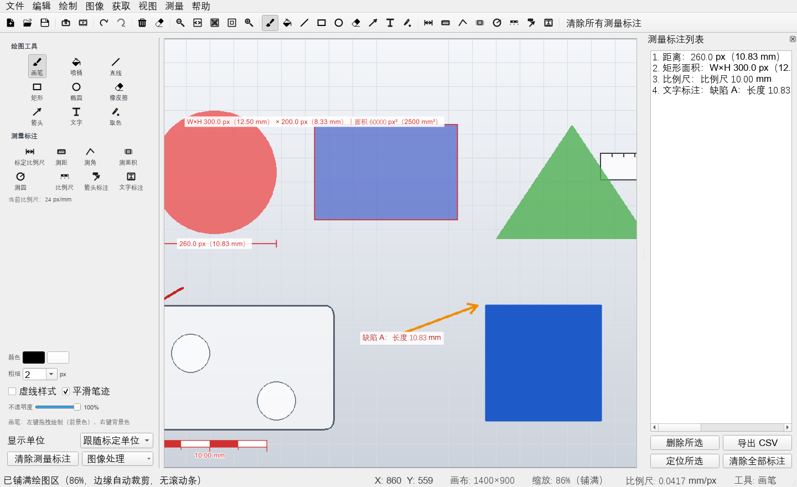
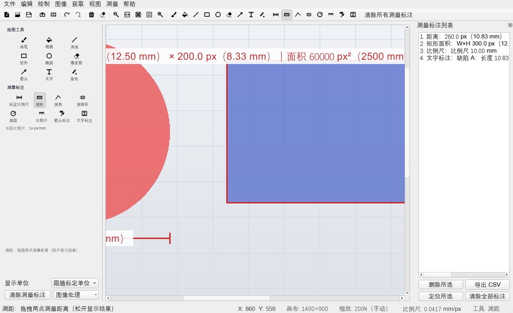

# PixelMark 像素标绘

**绘图 · 标注 · 测量一体化工作台**



## 这是什么

PixelMark 是一个基于 PyQt5 的桌面图像工作台，集**绘图**、**标注**与**测量**于一体：
覆盖画笔/喷桶/直线/矩形/椭圆/橡皮擦/箭头/文字/取色等绘图工具，灰度/二值化/反相/
浮雕/边缘/模糊/锐化等图像处理，以及测距、测角、测面积、测圆、比例尺标注等测量能力，
并支持撤销重做、摄像头拍照、视频截帧、视图缩放与单位换算。

适用于：缺陷标注、图纸测量、样本记录、教学演示等需要"画得出 + 量得准 + 说得清"的场景。

## 快速开始

```bash
# 依赖（Python 3.7+，推荐 3.9+）
pip install -r requirements.txt

# 运行
python run.py
```

> 摄像头与视频功能需要 OpenCV（`pip install opencv-python`）；
> 未安装时其余功能不受影响，仅在调用时给出友好提示。

## 功能总览

### 1. 绘图

| 工具 | 说明 |
| --- | --- |
| 画笔 / 喷桶 / 直线 / 矩形 / 椭圆 / 橡皮擦 | 左键前景色、右键背景色 |
| 箭头 | 带箭头头部 |
| 文字 | 单击画布输入内容与字号 |
| 取色器 | 单击拾取画布颜色为前景色 |

画笔属性：粗细（1–200 px）、前景/背景色、形状填充、虚线样式、平滑笔迹
（二次贝塞尔插值）、不透明度（10%–100%）。

> **工具选项与工具同屏**：左侧面板为平铺常显结构（无折叠）。选中某工具后，
> 「工具选项」区联动显示该工具的可调项——选画笔有粗细/颜色/平滑，选矩形有
> 填充/虚线，选测量工具有使用提示，不用再去其他折叠分组里翻找。

### 2. 测量标注（叠加层，不破坏原图，可拖动调整）

- **比例尺标定**：在已知长度的对象上画一条线 → 输入实际长度与单位 →
  之后所有测量同时显示像素值与实际值。
- **测距 / 测角 / 测面积（矩形）/ 测圆（R·D·面积）**：拖拽或多次点击完成。
- **比例尺图形**：单击放置"整齐长度"的分段比例尺，或**拖拽自定义长度**。
- **箭头标注 / 文字标注**：带引线的说明，可输入文字。
- **标注可编辑**：选中后整体拖动改位置、拖控制点调整端点/大小/角度，文字标注双击编辑。
- **测量列表面板**（右侧停靠）：单击选中高亮、双击/按钮**定位**到画布、
  **删除所选**、**清除全部标注**、**导出 CSV**。
- **显示单位切换**：mm / cm / m / μm / in 一键换算，或"跟随标定单位"。



### 3. 获取图像

- **摄像头拍照**：枚举可用摄像头，实时预览，拍照后直接载入画布。
- **从视频获取照片**：打开视频文件，逐帧步进 / 播放 / 拖动进度条定位，
  截取当前帧载入画布或保存为图片。
- 入口：工具栏图标 + 「获取」菜单（摄像头 / 视频截帧常驻可见）。

### 4. 图像处理

灰度化、二值化、反相、浮雕、边缘检测、模糊、锐化、图像信息；
基础调节对话框（亮度 / 对比度 / 饱和度 / 色调，实时预览，取消可还原）；
顺时针 / 逆时针旋转、垂直 / 水平翻转、还原到打开时的图像、清空画布。
滤镜、调节与旋转翻转同时提供「图像」菜单与「图像变换」工具栏两个入口。

### 5. 视图与交互

- 导入图像**自动铺满绘图区**：图像缩放至覆盖整个绘图区、居中裁剪边缘，
  画布与绘图区等大——不出现滚动条、不留边缘空白；窗口最大化 / 还原时自动重新计算。
- 缩放五档：放大 / 缩小 / **适应窗口**（Ctrl+0，整图可见）/ **铺满绘图区**
  （Ctrl+2，填满绘图区）/ 原始大小；工具栏与「视图」菜单均可操作，
  `Ctrl+滚轮` 缩放，中键拖拽平移；手动缩放退出自动模式后正常出现滚动条。
- 画布填满绘图区：图像外为浅灰底并带边框，明确勾出画布边界，不再有漆黑边缘。
- 工具栏为图标式全集：文件 / 获取 / 撤销重做 / 清空还原 / 缩放 / 全部工具 /
  清除测量标注；另起一行「图像变换」工具栏承载调节与滤镜。
- 「视图」菜单可分别显示/隐藏：测量面板、左侧工具面板、工具栏、状态栏。
- 状态栏实时显示：鼠标图像坐标、画布尺寸、**缩放比例与视图模式**（铺满 /
  适应窗口 / 手动）、比例尺、当前工具。
- 界面启动即最大化；左侧面板平铺常显，矮窗口下整页滚动，所有分组完整可达。



### 6. 撤销 / 重做

统一历史栈：绘图、图像处理、测量标注的操作交错也能正确回退
（`Ctrl+Z` / `Ctrl+Shift+Z` 或 `Ctrl+Y`），内存预算 256 MB、最多 40 步。

### 7. 错误处理与日志

- 全局异常钩子：未捕获异常弹出友好对话框而不是静默崩溃；
- 文件打开 / 保存 / 解码失败的明确提示（含原因）；
- 输入校验：笔刷大小、颜色取消、空画布保护、非法单位；
- 滚动文件日志：`logs/pixelmark.log`；
- OpenCV 惰性导入 + numpy/Pillow 回退，缺库不影响其余功能。

## 快捷键

| 分类 | 快捷键 |
| --- | --- |
| 文件 | Ctrl+N 新建 · Ctrl+O 打开 · Ctrl+S 保存（含标注）· Ctrl+Q 退出 |
| 编辑 | Ctrl+Z 撤销 · Ctrl+Shift+Z / Ctrl+Y 重做 · Delete 删除所选测量 · Esc 取消 |
| 视图 | Ctrl+= 放大 · Ctrl+- 缩小 · Ctrl+0 适应窗口 · Ctrl+2 铺满绘图区 · Ctrl+1 原始大小 |
| 工具 | B 画笔 · U 喷桶 · L 直线 · R 矩形 · O 椭圆 · E 橡皮擦 · A 箭头 · T 文字 · I 取色 |
| 测量 | C 标定 · D 测距 · G 测角 · M 面积 · V 测圆 · S 比例尺 · N 箭头标注 · Y 文字标注 |
| 帮助 | F1 使用说明 |

工具快捷键同时反映在「绘制 / 测量」菜单与工具栏的勾选状态上。

详细教程见 [docs/USAGE.md](docs/USAGE.md)，设计说明见 [docs/ARCHITECTURE.md](docs/ARCHITECTURE.md)。

## 项目结构

```
PixelMark/
├── run.py                     # 入口
├── requirements.txt
├── imgs.qrc / img_resources.py
├── img/                       # 图标（200x200 扁平风格）
├── pixelmark/
│   ├── app.py                 # 应用装配（日志/异常钩子/高DPI/资源）
│   ├── main_window.py         # 主窗口编排
│   ├── canvas.py              # 画布：绘图 + 测量交互 + 缩放视图
│   ├── capture.py             # 摄像头拍照 / 视频截帧
│   ├── dialogs.py             # 文字/标定/调节/帮助/关于对话框
│   ├── measurement.py         # 比例尺、几何计算、测量对象与绘制
│   ├── tools.py               # 工具注册表
│   ├── resources.py           # 图标加载（编译资源 + 磁盘回退）
│   ├── util/                  # 图像算法 / 错误 / 日志
│   └── view/                  # .ui 与 pyuic 生成代码
├── tools/                     # build_ui / make_icons / run_tests
├── tests/                     # 单元 + 无头 UI 测试
└── docs/                      # USAGE / ARCHITECTURE / 截图
```

## 测试

```bash
python tools/run_tests.py
```

当前 **52 项单元测试 + 192 项无头 UI 功能检查**全部通过
（覆盖全部工具、测量全流程、缩放坐标映射、单位换算、摄像头/视频降级路径、
保存/打开/导出、菜单/工具栏结构、工具选项显隐、动作勾选同步、铺满/适应窗口、
图标尺寸一致性、面板无滚动条、面板显隐、错误路径）。

## 许可

本项目采用 MIT 许可。
